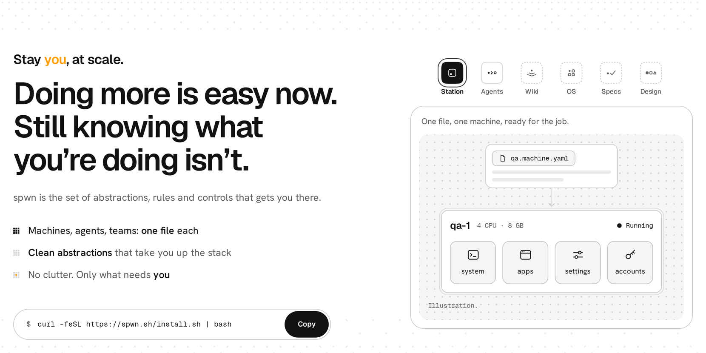

<h1 align="center">
  <br>
  spwn
</h1>

<p align="center">
  <a href="https://spwn.sh"><b>Website</b></a> ·
  <a href="https://spwn.sh/docs"><b>Docs</b></a> ·
  <a href="#the-three-spaces"><b>The three spaces</b></a>
</p>

<picture>
  <source media="(prefers-color-scheme: dark)" srcset="docs/_assets/readme/hero-dark.png">
  
</picture>

Spwn is a stack of apps and abstractions that lets one person build at the scale of a team, and still be the author of what gets built. It is three spaces: Machine, Agent and OS. Each takes one kind of work off your hands and leaves you the decision above it.

```sh
curl -fsSL https://spwn.sh/install.sh | bash
```

Two commands, one per running app: `spwn-machines` (short: `machines`) and `spwn-agents` (short: `agents`). One install puts both on your path.

> [!NOTE]
> **Alpha.** Two apps run today, Machines and Agents. Wiki, Specs and Design, which live in the OS space, are being made: their rows say so, and nothing here claims more. Expect rough edges, and [open an issue](https://github.com/jterrazz/spwn/issues) where you hit one.

## The three spaces

| Space       | What it holds                                                                 |
| ----------- | ----------------------------------------------------------------------------- |
| **Machine** | The premises: the fleet of machines, access, security, documents              |
| **Agent**   | The workforce: personalities, roles, focus, responsibilities                  |
| **OS**      | The steering: flows, projects, vision, products, the system, the abstractions |

Each space is made of apps. Wiki, Specs and Design live inside the OS space.

| App                                | What it does                 | State        | Command         | Folder                        |
| ---------------------------------- | ---------------------------- | ------------ | --------------- | ----------------------------- |
| [**Machines**](machines/README.md) | Machines built from one file | **Running**  | `spwn-machines` | `machines/`                   |
| [**Agents**](docs/README.md)       | One agent, any harness       | **Running**  | `spwn-agents`   | `apps/cli/` (later `agents/`) |
| **Wiki**                           | Each fact in one place       | _Being made_ | ·               | ·                             |
| **Specs**                          | Proof it is as asked         | _Being made_ | ·               | ·                             |
| **Design**                         | One family of shapes         | _Being made_ | ·               | ·                             |

In the app, the three spaces are distinct. A switch between them comes first, with Agent and OS greyed until they run.

## Commands, by app

<details open>
<summary><b>Machines</b> · <code>spwn-machines</code> · machines built from one file</summary>

```sh
spwn-machines init                                          # make this machine known
spwn-machines machines                                      # all machines: every Mac, its VMs, what needs you
spwn-machines machines create web --from qa.machine.yaml    # a machine from its Machinefile
spwn-machines apply                                         # carry out this machine's Machinefile
spwn-machines overview                                      # this machine at a glance
```

Every command: [Machines' command reference](machines/docs/reference/commands.md) · it runs on a Mac, and its VMs run on a hypervisor (`tart` today), see [the glossary](machines/docs/concepts/glossary.md).

</details>

<details>
<summary><b>Agents</b> · <code>spwn-agents</code> · one agent, any harness</summary>

```sh
spwn-agents auth            # check your agent runtime sign-in
spwn-agents init            # a project and its first agent, neo
spwn-agents agent neo       # talk to neo, in a sandboxed world
spwn-agents build           # one portable artifact
spwn-agents up              # bring a world up; down tears it down
spwn-agents check           # bad refs, missing files, lockfile drift
```

Every command: [Agents' command reference](docs/reference/commands.md) · runs on Claude Code or Codex · needs Docker · first steps in [Getting started](docs/start/getting-started.md).

</details>

## Repository map

```text
machines/     Machines: its code and its own manual, machines/docs/
apps/         Agents' surfaces: cli (the command), api, gate, web, spwn-cookie-sync
packages/     Agents: the packages behind them
catalog/      Agents: the blocks an agent is made of
docs/         the manual of the repository and of Agents
specs/        the suites that prove Agents
```

The Agents code sits at the root today, and `machines/` holds Machines. Next: Agents moves to `agents/`, and `app/` becomes a desktop app named spwn.

## Contributing

Build, test and release are the manual's: [Contributing](CONTRIBUTING.md), then [Develop](docs/guides/develop.md), [Test](docs/guides/test.md) and [Release](docs/guides/release.md). Machines keeps its own loop, [Develop](machines/docs/guides/develop.md). Why the two share one repository: [ADR-017](docs/decisions/017-one-repository-station-moves-in-under-machines.md).

## License

MIT, see [LICENSE](LICENSE).
